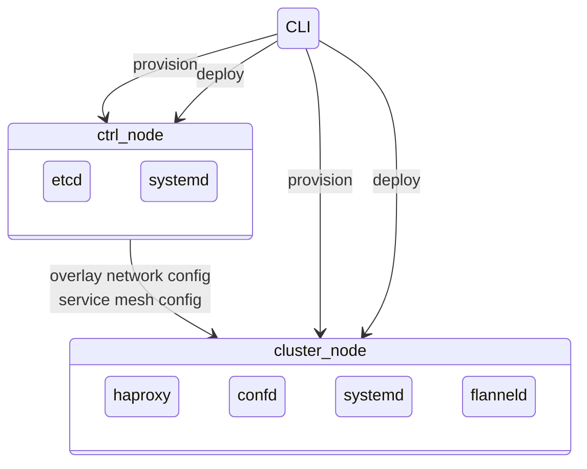
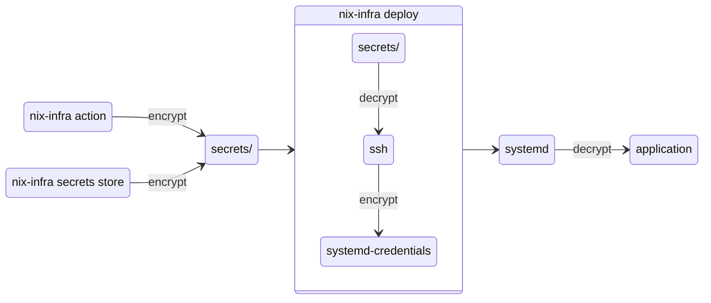
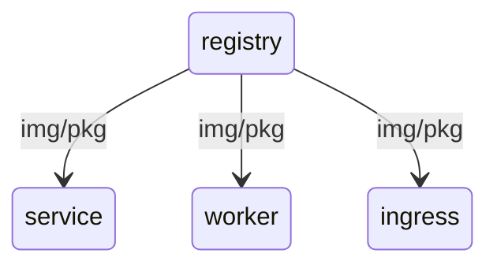
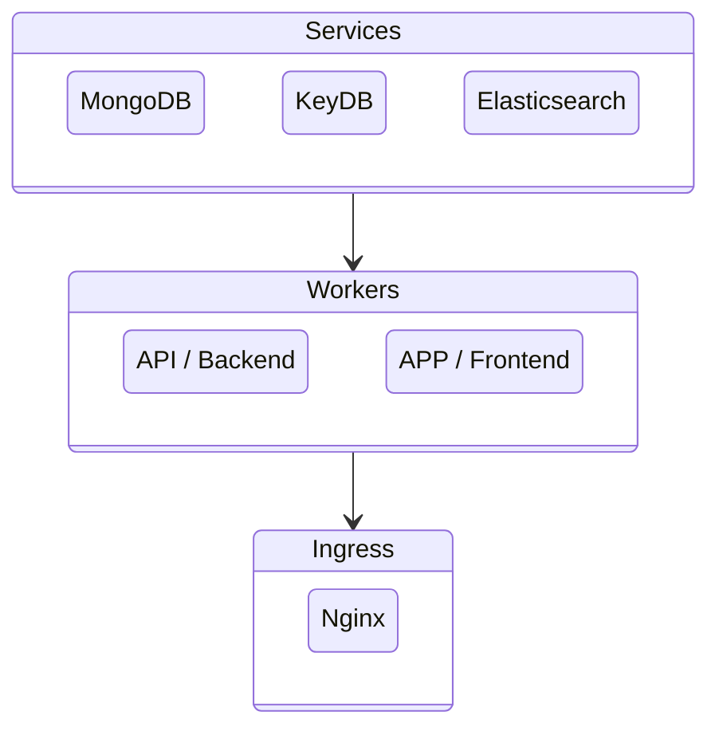

# Architecture

nix-infra is a Dart CLI tool that manages NixOS-based infrastructure. It supports two operational modes: **fleet** (standalone machines managed independently) and **cluster** (high-availability deployments with service mesh and overlay networking). This document explains how the major subsystems work together.

## CLI Structure

The CLI is built with Dart's `args` package and organized into command groups:

```
nix-infra
├── init                    # Initialize a new project (creates config folder, SSH keys, CA)
├── fleet                   # Fleet management (standalone machines)
│   ├── provision           # Create and install NixOS on machines
│   ├── init-machine        # Initialize machine with base config
│   ├── update              # Update machine configuration
│   ├── deploy-apps         # Deploy application configs and secrets
│   ├── destroy             # Destroy machines
│   ├── gc                  # Garbage collect old NixOS generations
│   ├── upgrade-nixos       # Upgrade NixOS version
│   ├── rollback            # Rollback to previous NixOS generation
│   ├── ssh                 # Open SSH session to a machine
│   ├── cmd                 # Run a command on machines
│   ├── port-forward        # Forward a port from a machine
│   ├── action              # Run a remote action script
│   └── upload              # Upload files to machines
├── cluster                 # Cluster management (HA with service mesh)
│   ├── provision           # Create and install NixOS on nodes
│   ├── init-ctrl           # Initialize control plane (etcd)
│   ├── update-ctrl         # Update control plane configuration
│   ├── init-node           # Initialize cluster worker/service nodes
│   ├── update-node         # Update cluster node configuration
│   ├── deploy-apps         # Deploy application configs and secrets
│   ├── destroy             # Unregister and destroy cluster nodes
│   ├── gc                  # Garbage collect old NixOS generations
│   ├── upgrade-nixos       # Upgrade NixOS version
│   ├── rollback            # Rollback to previous NixOS generation
│   ├── ssh                 # Open SSH session to a node
│   ├── cmd                 # Run a command on nodes
│   ├── port-forward        # Forward a port from a node
│   ├── action              # Run a remote action script
│   ├── upload              # Upload files to nodes
│   └── etcd                # Query etcd control plane
├── secrets                 # Secrets management
│   └── store               # Store a secret (from --secret, --secret-file, or stdin)
├── ssh-key                 # SSH key management
│   ├── create              # Create a new SSH key pair
│   ├── add                 # Register a public key at the cloud provider
│   └── remove              # Remove SSH key from cloud provider
├── registry                # Container registry management
│   ├── push                # Push container image to registry
│   └── create-cache-key    # Create nix store cache signing key
└── etcd                    # Direct etcd operations
    ├── get                 # Get a value from etcd
    ├── put                 # Put a value in etcd
    └── del                 # Delete a key from etcd
```

Common options shared across command groups:

- `--working-dir` / `-d` — Project directory (default: `.`)
- `--env` — Path to `.env` file (values from the environment win; see [Configuration and `.env`](#configuration-and-env))
- `--ssh-key` — SSH key name (overrides `SSH_KEY`; see [SSH keys](#ssh-keys) for `SSH_KEY_MAP_PATH`)
- `--debug` — Verbose debug logging (global: `nix-infra --debug cluster ...`, or per command group)
- `--batch` — Non-interactive mode (skips confirmations)

### Configuration and `.env`

nix-infra reads its configuration (`SECRETS_PASS`, `SSH_KEY`, `SSH_KEY_MAP_PATH`, `SSH_AUTH_SOCK`, `HCLOUD_TOKEN`, `CA_PASS`, ...) from the project `.env` (or the file given with `--env`) and from the process environment:

- A non-empty variable in the process environment wins over the same name in `.env`.
- An empty variable in the process environment (`FOO=`) does not hide a `.env` value.
- `$VAR` references inside `.env` are expanded by the dotenv parser, from earlier lines of the file first.

Every command, the MCP servers, `init` and `cert` follow this rule. It is implemented once, in `envWithProcessPrecedence` / `loadEnv` in `lib/helpers.dart`. Before 0.18.0-beta, `.env` won over the environment. A wrapper script that sources `.env` before it calls nix-infra replaces exported values first; see [Wrapper scripts](./SECRETS.md#wrapper-scripts).

### SSH keys

Each machine gets its SSH key from one of two sources; the key map decides (design: [ssh_agent_keys.md](./design/ssh_agent_keys.md)).

| | Key file | Agent |
|---|---|---|
| Chosen when | the key map does not name the machine, or there is no key map | the key map names the machine, or has a `default` |
| Private key | a file (see the order below) | stays in the `ssh-agent` at `SSH_AUTH_SOCK`; nix-infra asks the agent to sign and never sees it |
| Public key | `<private key>.pub` when that file exists, else derived from the private key | the public key that the agent lists |
| Key name `SSH_KEY` | required (`SSH_KEY` or `--ssh-key`); with a key map only for `ssh/<SSH_KEY>` | not required to connect |

**The key map** is a JSON file named by `SSH_KEY_MAP_PATH` (absolute, or relative to the project folder; `~` is not expanded). It holds fingerprints, no key and no secret:

```json
{
  "version": 1,
  "default": { "agent_key": "SHA256:Yk0nDTpL0dQ4Jw0b4QnP3o1bq0oT1dS6r0Qe2m9uJ3c" },
  "nodes": {
    "web-1": { "agent_key": "SHA256:u2l0c8QfR1vN0mJ5rT8hD4kX9aYb3Wq7eZs6PpLo1Hg" },
    "db-1":  { "unavailable": "secrets_locked", "ring": "interactive" }
  }
}
```

`version` must be the number `1`; `default` and `nodes` are optional. An entry has either `agent_key` (the SHA-256 fingerprint in the form that `ssh-add -l` prints, compared exactly) or `unavailable` (a reason), the latter with an optional `ring`; unknown fields are ignored at every level. A machine name is compared exactly; there are no patterns. The file is read each time the machines are listed, so a caller may write it again while an MCP server runs. A key map that cannot be read, or does not follow this schema, stops a command before it connects, or the start of an MCP server; one that cannot be read later makes every machine of that listing unavailable.

**The key of one machine** — the first rule that names the machine decides:

1. `nodes[<name>]` of the key map;
2. `default` of the key map;
3. `ssh_key` of the machine in `servers.yaml` (absolute, or relative to the project);
4. `<project>/ssh/<SSH_KEY>` (or `--ssh-key`).

There is no fall-through after rule 1 or 2: an `unavailable` entry, an agent that cannot be reached, an agent that does not hold the key and a key map that cannot be read are errors for that machine. A machine is never tried with another key than the one chosen for it, and nix-infra never offers every key of the agent. `SSH_AUTH_SOCK` alone changes nothing: a developer's own agent is used only when a key map names the machine. nix-infra asks the agent at each login and keeps nothing of it between two logins, so a key that the caller removed from the agent (a locked sysops vault) gives a clear error.

All code that reaches a machine goes through `lib/ssh_identity.dart`: `identitiesOf` (the dartssh2 login), `publicKeyOf` (root's authorized key, `[%%sshKey%%]` in `configuration.nix`) and `sshCommand` (the `ssh` command line of `provision`, `registry` and the deployment of secrets). With an agent key, `ssh` runs with `-o IdentityAgent=<socket> -o IdentitiesOnly=yes -o ForwardAgent=no -i <public key file>`, where the public key of the machine is written to a temporary file (mode 600) that is deleted after the command; the agent is never forwarded.

`provision` (on Hetzner Cloud) and `ssh-key add` register the public key of the `default` entry of the key map at the cloud provider, under the key name (`provision`: `SSH_KEY` or `--ssh-key`; `ssh-key add`: `--name`), so they still need the name. A key map without a `default` entry, or whose `default` key cannot be had from the agent (an `unavailable` entry, a key that the agent does not hold), is an error there. `init` and `ssh-key create` make key files as before; they never put a key into an agent.

A key file with a passphrase cannot be used.

With a key map, `SSH_KEY` is optional for the commands that only connect (`cmd`, `ssh`, `upload`, `update`, `deploy-apps`, `init-machine`, ...); a machine that the key map does not name then needs `ssh_key` in `servers.yaml`, or the key name. `provision` still needs the key name (`SSH_KEY` or `--ssh-key`), because it gives the name to the cloud provider. The MCP servers (`nix-infra-*-mcp`) need `SSH_KEY` and its key files, or a key map (then `SSH_KEY` is not required; see [MCP Servers](#mcp-servers)). The dev MCP server passes `SSH_KEY_MAP_PATH` (as an absolute path) and `SSH_AUTH_SOCK` to the scripts that it starts, when a key map is set. `ProviderFactory.autoDetect` takes the resolved values as the optional parameters `sshKeyMapPath` and `sshAgentSocket` and does not read the variables itself.

**Errors.** No text of an MCP tool, and no line on the stderr of an MCP server, names the path of a key file, of the key map or of the agent socket; a text may name the machine, a variable and a fingerprint. The CLI shows the same texts, and may name a path elsewhere (for example of a key map that it cannot read at the start).

| Case | Text |
|---|---|
| An `unavailable` entry | `The SSH key of machine "<name>" is not available (<reason>).` (with a `ring`: `(<reason>, ring <ring>)`) |
| The key map cannot be read when the machines are listed (after the start) | `The key map of this session cannot be read. The key of machine "<name>" is not available.` |
| An agent key, but no `SSH_AUTH_SOCK` | `SSH_KEY_MAP_PATH is set but SSH_AUTH_SOCK is not.` |
| The agent cannot be reached | `The SSH agent of this session cannot be reached. The key of machine "<name>" is not available.` |
| The agent does not hold the key, or refuses to sign | `The SSH agent does not hold the key of machine "<name>" (<fingerprint>). If sysops filled the agent: the vault may be locked.` |
| Another error of the agent (no answer in time, an answer that breaks the protocol) | `The SSH agent of this session failed for the key of machine "<name>" (<fingerprint>): <what went wrong>` |
| The machine does not accept the agent key | `Machine "<name>" does not accept its key (<fingerprint>).` |
| The key file is missing, cannot be read, has a passphrase, or is not a private key | `The SSH key file of machine "<name>" does not exist.`, `... cannot be read.`, `... has a passphrase; nix-infra cannot use it.`, `... is not a private key that nix-infra can read.` |

## Provider Abstraction

nix-infra uses a provider abstraction layer so the same CLI commands work with different infrastructure backends.

The `InfrastructureProvider` interface defines the contract:

- `getServers()` — List available servers
- `createServer()` — Provision a new server
- `destroyServer()` — Remove a server
- `getIpAddr()` — Look up a server's IP
- `addSshKeyToCloudProvider()` / `removeSshKeyFromCloudProvider()` — Manage SSH keys

Each provider declares its capabilities (`supportsCreateServer`, `supportsDestroyServer`, `supportsPlacementGroups`, `supportsAddSshKey`), allowing the CLI to adapt behavior accordingly.

### Provider Auto-Detection

The `ProviderFactory` automatically selects the right provider:

1. If `servers.yaml` exists in the working directory → **SelfHosting** provider
2. If `HCLOUD_TOKEN` is set in the environment or `.env` → **HetznerCloud** provider
3. Otherwise → error

### Hybrid Mode

The SelfHosting provider supports a hybrid mode where some entries in `servers.yaml` reference a cloud provider (e.g., `provider: hetzner`). In this case, the SelfHosting provider delegates IP resolution for those entries to the appropriate cloud provider instance, enabling mixed environments with both self-hosted and cloud-managed servers.

## Provisioning Pipeline

The provisioning pipeline converts a bare server (running any supported Linux distribution) into a NixOS machine:


**Step by step:**

1. **createNodes()** — For cloud providers (HetznerCloud), creates new servers via the API. Handles placement groups for HA. Skips existing nodes.
2. **waitForServers()** — Polls the cloud API until servers report ready. For self-hosted servers, this step is skipped.
3. **installNixos()** — Converts the base OS to NixOS using [nixos-infect](https://github.com/jhsware/nixos-infect). Uploads an install script and a base `configuration.nix` via SFTP, then executes the install over SSH. The install script is built per node: nodes hosted on Hetzner Cloud (created via the API, or `provider: hetzner` in `servers.yaml`) run nixos-infect with `PROVIDER=hetznercloud`, static self-hosted nodes without it. The script runs with `set -euo pipefail` and verifies each step (nixos-infect exit code, `configuration.nix` install, NixOS system profile, bootloader install, NixOS entry in the GRUB menu). Before the install it prints node boot facts (`NIX_INFRA_FACT`: boot mode EFI/BIOS, disks, efibootmgr entries). On failure it prints `NIX_INFRA_FAIL <node>: <reason>` and exits without rebooting, so the node stays reachable over SSH; on success it prints `NIX_INFRA_OK <node>` and reboots. Supports a `--mutation` option for VMware and other non-standard environments.
4. **waitForSsh()** — Waits for SSH to become available after the server reboots into NixOS. Nodes that failed the install checks are skipped here and reported instead.
5. **nixos-rebuild switch** — Runs the initial NixOS rebuild to apply the configuration.

## Configuration Deployment

nix-infra delivers NixOS configuration files to each node via SFTP. The deployment uploads a standard set of files:

- `configuration.nix` — Base system configuration
- `flake.nix` — Nix flake definition (pinned nixpkgs version)
- `cluster_node.nix` or `control_node.nix` — Node type definition
- `modules/` — Shared NixOS modules
- `app_modules/` — Application-specific modules (recursive upload)
- `nodes/<node_name>.nix` — Per-node app configuration

### Variable Substitution

Config files use a placeholder syntax `[%%key%%]` that gets replaced at deploy time. The substitution system supports these types of placeholders:

| Placeholder | Example | Replaced With |
|-------------|---------|---------------|
| Simple variables | `[%%nodeName%%]`, `[%%nixVersion%%]` | The corresponding value from the substitution map |
| Node IP addresses | `[%%worker001.ipv4%%]` | The public IP address of the named node |
| Overlay IPs | `[%%worker001.overlayIp%%]` | The WireGuard overlay IP of the named node (cluster mode) |
| Secrets | `[%%secrets/api-key%%]` | The secret name (file deployed separately via systemd-creds) |
| Netrc secrets | `[%%secrets.netrc/github-netrc%%]` | The secret name (deployed via systemd-creds AND pre-decrypted into combined-netrc before rebuild) |
The substitution is performed by the `substitute()` function in `lib/helpers.dart`. When a `[%%secrets/...%%]` placeholder is encountered, the secret name is added to a list of expected secrets that the deployment pipeline then provisions on the target node.


## Service Mesh (Cluster Mode)

In cluster mode, nix-infra sets up a service mesh using etcd, confd, and HAProxy:



**How it works:**

- **etcd** runs on control nodes and stores service registration data (node IPs, service endpoints, ports)
- **confd** watches etcd for changes and regenerates HAProxy configuration templates
- **HAProxy** load-balances traffic between service instances based on the confd-generated config
- When nodes or services are added/removed, `registerClusterNode()` / `unregisterClusterNode()` updates etcd, and confd propagates the changes to HAProxy

### etcd Data Model

```
/cluster/nodes/<node_name>          → { name, ipv4, services[] }
/cluster/frontends/<app>/instances/<node>  → { node, ipv4, port }
/cluster/frontends/<app>/meta_data  → { publish: {port}, env_prefix, env }
/cluster/backends/<app>/instances/<node>   → { node, ipv4, port }
/cluster/backends/<app>/meta_data   → { publish: {port}, env_prefix, env }
/cluster/services/<app>/instances/<node>   → { node, ipv4, port }
/cluster/services/<app>/meta_data   → { publish: {port}, env_prefix, env }
```

Nodes register with the service types they need access to (`services`, `frontends`, `backends`). HAProxy uses the `publish.port` from metadata to expose services on the correct port on each worker node.

## Overlay Network (Cluster Mode)

The cluster uses **Flanneld** with **WireGuard** encryption for the overlay network:

- Flanneld manages subnet allocation, storing subnet-to-node mappings in etcd under `/coreos.com/network/subnets`
- Each node gets a subnet from which overlay IPs are assigned
- WireGuard provides encryption for all inter-node traffic on the overlay
- Overlay IPs are resolved from etcd during deployment and substituted into configuration files via `[%%nodeName.overlayIp%%]`

This allows services to communicate using stable overlay IPs regardless of the underlying network topology or datacenter location.

## Secrets System

Secrets flow through three stages:



1. **Storage** — Secrets are encrypted locally using OpenSSL (`openssl enc -pbkdf2`) with a password and stored in the `secrets/` directory.
2. **Deployment** — During deploy, secrets are decrypted locally, sent over SSH, and re-encrypted on the target using `systemd-creds encrypt` into `/root/secrets/`.
3. **Runtime** — systemd services decrypt secrets at startup using `systemd-creds`.

The `syncSecrets()` function ensures only expected secrets exist on each node, removing any that are no longer referenced.


The `syncSecrets()` function ensures only expected secrets exist on each node, removing any that are no longer referenced.

## Certificate Authority

nix-infra creates a local PKI for securing etcd communication:

1. **Root CA** — 4096-bit RSA key, self-signed certificate valid for 20 years
2. **Intermediate CA** — 4096-bit RSA key, signed by root CA, valid for 10 years
3. **Node certificates** — 2048-bit RSA keys signed by intermediate CA, valid for 5 years
   - **Client TLS certificates** — For client-to-etcd authentication
   - **Peer TLS certificates** — For etcd peer-to-peer communication (control nodes only)

The certificate chain (`ca-chain.cert.pem`) is deployed to `/root/certs/` on each node along with the node-specific key and certificate files. etcdctl commands use these certificates for all etcd communication.

Certificates include `subjectAltName` entries with the node's IP address and `127.0.0.1` for local access.

## Container Registry

The registry node provides a private OCI container registry for distributing container images across the cluster:



Nodes can also use a nix store cache with trusted public keys for distributing packages, managed via the `registry create-cache-key` command.

## Service Topology (Cluster Mode)

The cluster uses a three-layer architecture:



- **Services** — Stateful workloads (databases) on dedicated service nodes
- **Workers** — Stateless application containers on worker nodes
- **Ingress** — Nginx reverse proxy exposing the cluster to the internet

## MCP Servers

nix-infra includes three experimental MCP (Model Context Protocol) servers for AI-assisted infrastructure management:

- **nix-infra-cluster-mcp** — Read-only access to cluster infrastructure (node stats, systemd units, journalctl logs, etcd queries)
- **nix-infra-machine-mcp** — Read-only access to standalone machine fleets
- **nix-infra-dev-mcp** — Read/write access for project development (edit app modules, run tests, manage test environments)

The infrastructure MCPs enforce read-only access with command whitelists and blacklists. The dev MCP restricts filesystem access to project directories (`app_modules/`, `modules/`, `node_types/`, `__test__/`).

The MCP servers take their SSH keys as the CLI does (see [SSH keys](#ssh-keys)): `SSH_KEY` and its key files, or a key map (`SSH_KEY_MAP_PATH`; then `SSH_KEY` is not required). A key map that cannot be read, or does not follow its schema, stops the start with `ERROR! SSH_KEY_MAP_PATH: <what is wrong>` on stderr; without `SSH_KEY` and without a key map the start stops with `ERROR! env-var SSH_KEY is missing`. `nix-infra-machine-mcp` and `nix-infra-cluster-mcp` take `--ssh-timeout=<seconds>` (default 10). It bounds the TCP connect, the SSH handshake and the login of each connection of a tool, each of them, and each request to the `ssh-agent`; it applies to every tool that connects, `etcd` and `file-upload` included. The CLI sets no timeout on the handshake and the login, and a request to the agent waits at most 30 seconds there. The tool `file-upload` takes local paths inside the project folder only (see [File Upload](./SECURITY.md#file-upload)).

## Node Lifecycle

1. **Provision** — Create server and install NixOS
2. **Initialize** — Deploy base configuration and node type
3. **Register** — Add node to etcd (cluster mode only)
4. **Deploy** — Push application configurations and secrets
5. **Unregister** — Remove from etcd (cluster mode only)
6. **Destroy** — Destroy the server (cloud providers only)

## App Lifecycle (Cluster Mode)

1. **Register app** — Add app metadata to etcd
2. **Deploy app to node** — Upload app module and node config
3. **Register app instance** — Add instance endpoint to etcd
4. **Unregister app instance** — Remove instance from etcd
5. **Remove app from node** — Remove app configuration
6. **Unregister app** — Remove app metadata from etcd
